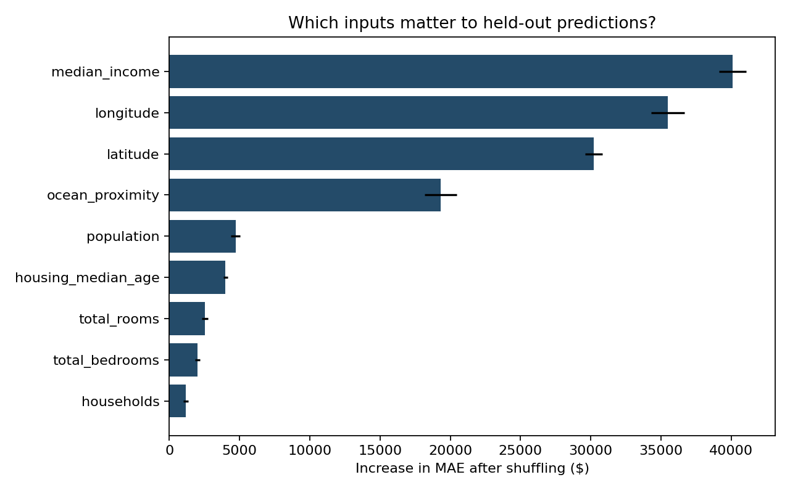
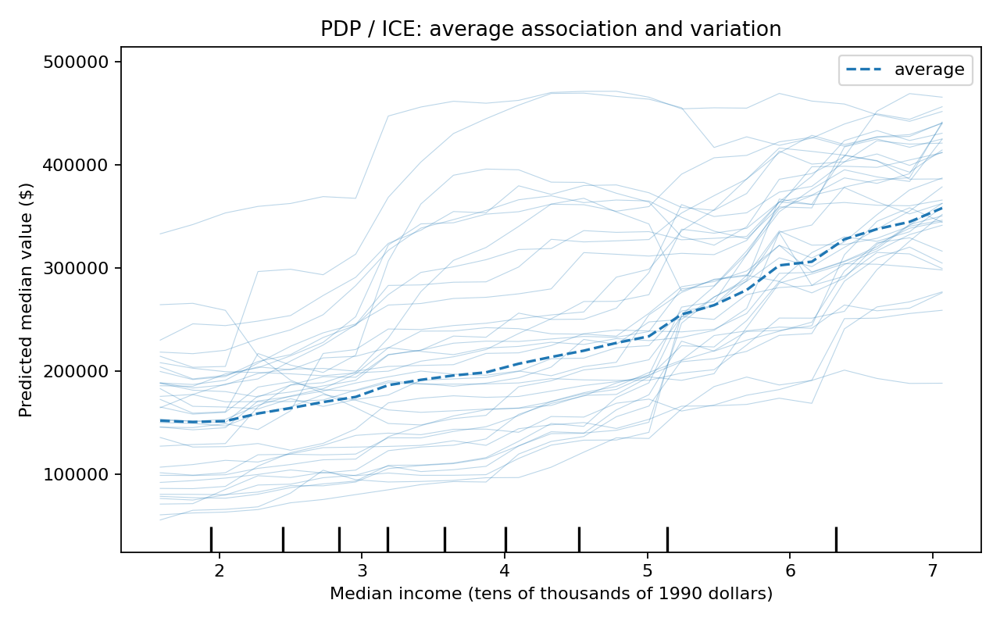
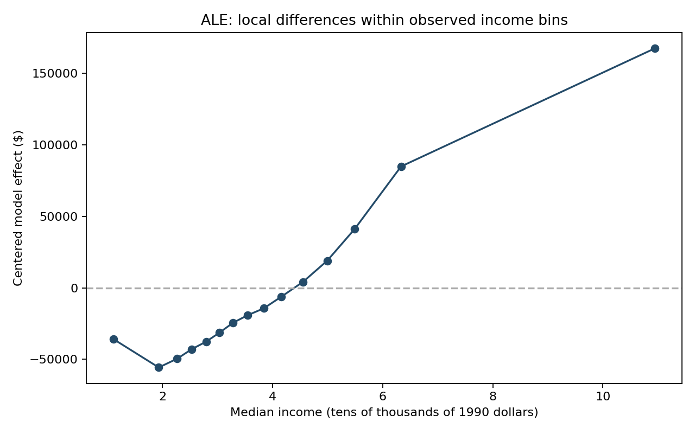

# Housing Price Prediction & Explainability

A Random Forest regression study of California census-district housing values, with transparent evaluation and model-effect plots.

## Business value
Explain which area-level characteristics help a pricing model, compare nonlinear predictions with simple baselines, and communicate variation behind average effects.

## Held-out results
| Model | MAE | RMSE | R2 |
| --- | --- | --- | --- |
| Mean baseline | 90606.8549 | 114485.6354 | -0.0002 |
| Linear Regression | 50670.4892 | 70059.1933 | 0.6254 |
| Random Forest | 31461.5257 | 48597.6982 | 0.8198 |

20,640 districts; random 80/20 split with seed 42. Numeric imputation and categorical encoding are fitted only on training rows. MAE/RMSE are dollars, R² is dimensionless. The forest uses 150 trees and max_features=0.8; no cross-validation or tuning search is claimed. A random split may overstate performance on genuinely new geographic areas.

## Three complementary views

Shuffling an input measures its impact on held-out MAE. Correlated features may share importance; estimates use 1,200 test rows and five shuffles.


PDP summarizes average model association while ICE shows individual variation. Artificial feature combinations can be unrealistic when features correlate.


ALE averages finite prediction differences within observed income quantile bins and accumulates centered effects. It reduces some extrapolation from PDP but remains a model explanation, not a causal estimate. The implementation is checked against a known additive linear effect.

## Run
```bash
git clone https://github.com/YirenShen-07/HousingPriceAnalysis.git
cd HousingPriceAnalysis
python -m venv .venv
# macOS / Linux:
source .venv/bin/activate
# Windows PowerShell: .venv\Scripts\Activate.ps1
python -m pip install -r requirements.txt
python download_data.py
python analyze.py
python -m unittest test_ale.py
```
Python 3.12 was used for verification. Data downloads from the public Hands-On ML repository, without Drive credentials. [Notebook](housing_price_explainability.ipynb) · [Reports](reports/) · [DATA.md](DATA.md).

## Data interpretation
Each row is a census district, not an individual property. total_rooms, population and households are district totals. median_income is in tens of thousands of dollars, with capped values. The target is district median housing value, also capped. These historic census values are not current property appraisals.

## Project context
Original Duke AIPI 590 project by Yiren Shen. Reproducibility, metrics and code corrections were added with AI assistance in the 2026 portfolio maintenance pass.
